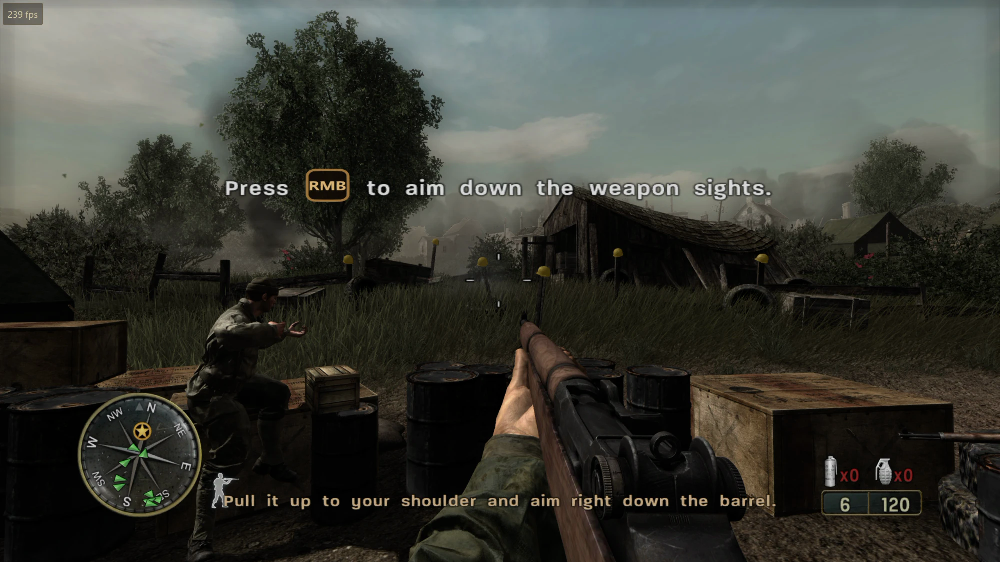

# CoD3Recomp

> **Still in development: bugs can and will occur.** A build ready to play,
> with your own Xbox 360 disc image, is on the
> [releases page](https://github.com/FrankHUN88453/CoD3Recomp/releases).
>
> *Még fejlesztés alatt: hibák előfordulhatnak.*

Static recompilation of Call of Duty 3 (Xbox 360) to native x86-64, using
[XenonRecomp](https://github.com/hedge-dev/XenonRecomp).

The game's PowerPC code translates to C++ and compiles cleanly: 19,462
functions, every instruction translated. All 179 Xbox 360 kernel imports are
implemented, memory mapped I/O reaches the GPU register file, and a command
processor decodes the packets the graphics driver queues.

`CoD3SP_s.exe` installs the game from your own disc image and boots it into a window.
The first level, Saint-Lô, is playable: the menus, the loading screen, the
opening cutscene and the fighting run at the title's own 60 frames a second
on the host's GPU through a Direct3D 11 renderer built for a PC (see
[docs/renderer.md](docs/renderer.md)), drawn from the title's own shaders
translated to HLSL, with the terrain, the buildings, the soldiers, the grass,
the sky, the shadows, the HUD and the saved checkpoints all working, at the
window's resolution with mip mapped, anisotropically filtered textures,
FXAA and vertical sync. All fifteen levels' code is recompiled and every
level loads and plays, the mission title cards, the mission failed screen
and the checkpoints with them. The sound plays, the title's XMA voices
decoded through FFmpeg, and so do the films: the legal notice, the
Activision and Treyarch logos, the attract loop and each mission's
briefing, through the title's own player, with Space (the A button) to
skip them.



### Keys and mouse

The keyboard and mouse stand in for the console's pad. In a level the window
takes the mouse and looks with it; Escape gives it back and pauses; a click
takes it again. Every key can be changed in the settings menu.

The game's own menus are pointed at: the entry under the pointer is
highlighted and a click takes it, the right button or Escape goes back. The
arrows either side of an option's value are clicked as the cross's left
and right are pressed (and again while held), a click on the value is the
next one, a slider's halves step it down and up, the questions' Yes and No
are clicked, and so are the chapter select's arrows and pictures (a picture
beside the chosen one goes to it, the chosen one starts it). A menu that
opens in a level (the pause menu, a mission's end) lets the pointer go
while it is up, and the window takes it again when it closes.

The main menu's XBOX LIVE MARKETPLACE is QUIT, which closes the game; so
does closing the window, and the console window it was started with closes
with it.

The prompts follow what is played with: after a key or the mouse the
game's button icons are drawn as the keys the settings give each button
(Enter and Escape in the menus), and the hints that name the sticks or the
buttons in words name the mouse and the keys; after the controller they are
the console's again. The settings menu can also hold them to one or the
other (Controls, Button prompts).

The look reads the mouse's own movement, the counts its device reports,
rather than following the pointer across the screen: Windows' pointer
speed and its "enhance pointer precision" do not reach it, so the same
sweep of the hand is the same turn on every machine. The settings menu
turns that off for anyone who wants the pointer's travel back.

| | |
| --- | --- |
| Mouse | look; Mouse 1 fires, Mouse 2 aims; the wheel changes weapon |
| W A S D | move |
| Space | jump |
| C | crouch |
| E / R | use / reload |
| F | change weapon |
| V | melee |
| G / 4 | grenade / smoke |
| Shift | sprint (the multiplayer's, whose commands the single player had left empty, put back; the stance figure shows the breath left, as the multiplayer's does) |
| B | binoculars |
| Tab | objectives (held) |
| Escape | pause |
| Enter, arrows | the menus |
| F11 | settings menu |
| F12 | screenshot into `screenshots/`, the next two frames' draws into `CoD3.log`, and a small picture after each draw of the next frame (`screenshots/*-draws.bin`): press it when something looks wrong |
| ` (the key left of 1) | the console, when the settings' Gameplay page turns it on |

The game's own OPTIONS has a VIDEO page beside GAMEPLAY, CONTROLS, SOUND
and SCREEN, in its own look: the resolution, the window mode, the aspect
ratio, the resolution scale, the field of view, the anti aliasing, the
texture filtering, anisotropy and quality, the shadow quality, the model
detail, vertical sync and the frame rate, each
changed with the arrows (the list scrolls with the wheel). The aspect ratio
makes a level wider than the console's 16:9 (21:9, 32:9, or as the window
is): more is seen to either side, and the HUD keeps its shape in the
middle. The shadow quality sets the shadow maps' size apart from the
frame's (the console's are 512 square).

The settings menu (F11) has the window
mode (windowed or borderless full screen; Alt+Enter switches too), the
resolution (the desktop's by default; the window is made that size, full
screen scales it, and the frame is drawn at it) and the resolution scale
in per cent of it, the texture filtering
and anisotropy, anti aliasing (MSAA 2x to 8x, FXAA, or both), the
texture quality, the shadow quality, the aspect ratio, the field of view (65 to 100), the model detail (the
game's own level of detail, or the finest model at every distance),
vertical sync, the frame rate in a level (unlimited by default: a level
is played at what the machine can do, around a hundred frames a second
where the console had sixty, while the menus keep 60 and the films
their 30), a frame counter and the renderer's statistics, the mouse
sensitivity and whether the mouse is read raw, the title's aim assist,
the pad, and the keys; on its Gameplay page the subtitles (the title's
`cg_subtitles`) and the console, and on its Experimental page the native
command lists and the memory write watch (both on by default; the draws
come from the game's own D3D calls rather than from its GPU command stream). It is drawn
in the colours of the title's own menus. It keeps its values in `CoD3Recomp.ini` beside the
executable. Everything the game prints goes to `CoD3.log` beside the
executable as well as to its console, and the run before is kept as
`CoD3.previous.log`: after a freeze or a crash, that file says where every
thread stood (`COD3_LOG=0` turns it off, `COD3_LOG=path` puts it
elsewhere). The same settings can be forced
from the environment for a run: `COD3_SCALE`, `COD3_TEXTURE_FILTER`,
`COD3_RESSCALE`, `COD3_ANISO`, `COD3_AA`, `COD3_TEXQUALITY`, `COD3_MODELDETAIL`, `COD3_VSYNC`, `COD3_UNLOCKFPS`, `COD3_FULLSCREEN`;
`COD3_EXEC="command;command"` runs the title's console commands at start;
`COD3_RENDER_STATS=1` prints the renderer's counters once a second and
`COD3_RENDER_PROFILE=1` where a draw's microseconds go.

The console (the key left of 1, which the title's own configs bind to
`toggleconsole`; off until the Gameplay page turns it on) drops from the
top of the screen as the Call of Duty engines' own does, and takes the title's console commands and puts them on its
command buffer, the way the chapter select starts a level: `spmap forest`,
`map_restart`, `cg_fov 80`, `timescale 0.5`, `god`, `noclip`, `give all`,
`seta com_maxfps 60`. The title's own console was stripped from this build
(its `toggleconsole` command and its `Com_Printf` are gone), so the
commands run but the title says nothing back; `help` lists examples,
`clear` empties the log, Escape closes it.

Saved games go to `saves/` beside the executable.

A pad works as well when one is plugged in.

Read [STATUS.md](STATUS.md) for what works, how it was measured, and what a
playable build would take.

The instructions this project added to the recompiler are checked against Xenia's
PowerPC instruction tests, and all 16 that have a test pass.

## Build

```powershell
.\scripts\recompile.ps1 -BuildTools -BuildLib -BuildHost
```

Needs CMake 3.20+, Ninja, Clang, and the Visual Studio Build Tools for the
Windows SDK headers. Clang is required, not preferred.

Put your own `default.xex` in `CoD3RecompLib/private/` first, so the recompiler
has something to translate. No game files are included here.

## Verifying

```powershell
.\scripts\verify.ps1        # the instructions this project added
.\scripts\verify.ps1 -All   # every test Xenia has
```

Assembles Xenia's instruction tests, recompiles them the same way the game's
code is recompiled, runs them, and reports any register that comes out wrong.

## Running

`CoD3SP_s.exe` is the whole program: FFmpeg's libraries, for the sound and
the films, are built into it and unpacked into
`%LOCALAPPDATA%\CoD3Recomp\libraries` when it starts. On its first start it
asks in its console window whether this is a fresh install or the game is
already installed:

1. Fresh install: choose your Xbox 360 disc image (XGD1, XGD2, XGD3 and
   stripped images are all recognised), then the main folder to extract it
   into.
2. Already installed: choose the game's main folder, the one that holds
   `default.xex`.

The main folder is the game folder: the game's files, and the saves in its
`save` folder. Its path is remembered in `game.path` beside the executable.
An executable put in the main folder itself, or beside the `game` folder
earlier builds made, finds it without asking; the first time, the saves of
an earlier build (its `saves` folder beside the executable) are copied into
an empty `save` folder, and the old folder is left as it was.

Setup checks that the disc holds a `default.xex` of the same size as the one
this build was recompiled from, before writing several gigabytes.

At every start the executable asks GitHub whether a newer release is out.
If one is, it downloads that release's `CoD3SP_s.exe`, puts it in its own
place (the one it replaces is kept as `CoD3SP_s.exe.old` until the next
start) and starts it. `--no-update`, `auto_update = 0` under `[game]` in
`CoD3Recomp.ini` or `COD3_NOUPDATE=1` leave it as it is.

Started from Explorer, a run that ends before the game's window opens (the
setup, an error) waits for a key before closing, so the output can be read;
once the game is up, closing its window (or QUIT) ends it at once, the
console window with it, and `CoD3.log` keeps what was printed. Started from
a shell it exits straight away and leaves the prompt alone.

The picker dialogs can be skipped:

```
CoD3SP_s.exe --iso "D:\path\Call of Duty 3.iso" --main "D:\Games\CoD3"
CoD3SP_s.exe --game "D:\Games\CoD3"
CoD3SP_s.exe --list-iso "D:\path\Call of Duty 3.iso"
CoD3SP_s.exe --help
```

A level can be started straight from the main menu, the way the chapter
select does it, with `COD3_MAP=<level>[,<second>]` in the environment: at that
second (twelve by default) the title's own `spmap <level>` console command is
put on its command buffer. The main menu has to be up by then, which
`COD3_NOFILMS=1` (no intro films) and `COD3_PAD="5:start 8:a"` (Start at
five seconds, A at eight) see to in a scripted run. The level names are the folders under `sp`: `saint_lo`,
`island`, `nightd`, `crssrds`, `hostage`, `mayenne`, `forest`, `falaise`,
`fuelplnt`, `chambois`, `mace2`, `laison`, `stbert`, `blkbrn`, `credits`.
`COD3_WIN=<second>:<level>` marks the running mission won at that second
with `<level>` as the next, the way a level script does, to test the way
from one mission to the next: the title reboots itself for it, and this
executable starts again with the title's launch data (`COD3_LAUNCHDATA`).
`COD3_CMD="22:god"` puts the title's own console commands on its buffer.

## Layout

| Path | |
| --- | --- |
| `CoD3RecompLib/config/CoD3.toml` | Recompiler configuration, with every address documented |
| `CoD3RecompLib/config/CoD3_switch_tables.toml` | 323 jump tables, from XenonAnalyse |
| `CoD3RecompLib/ppc/` | Generated C++. Never edit; regenerate |
| `CoD3RecompLib/private/` | Your game files. Not in version control |
| `CoD3Host/` | The executable: setup, disc image reader, guest memory, the kernel |
| `CoD3Host/kernel_*.cpp` | The kernel by area: memory, system, objects, files, Xam, threads |
| `CoD3Host/implemented_imports.txt` | Which imports are real. Add a name here when you implement one |
| `CoD3Host/kernel_stubs.cpp` | Generated for everything not on that list |
| `tools/XenonRecomp/` | The recompiler, with local fixes described in STATUS.md |
| `CoD3Host/xenos_hlsl.cpp` | The title's shader microcode translated to HLSL |
| `CoD3Host/render*.cpp` | The renderer: the registers read once (`render_state`), the PC render layer that makes draw commands of them (`render_commands`), the pipeline, shader and resource caches, the stats, and the Direct3D 11 executor and device (`render_d3d11`) ([docs/renderer.md](docs/renderer.md)) |
| `scripts/compare_frames.py` | Compares two runs' frame dumps, for the renderer's visual regression check |
| `scripts/sendkeys.py` | Posts keys to the game's window without taking the focus, for scripted runs (the console included) |
| `CoD3Host/overlay.cpp`, `settings.cpp` | The settings menu (Dear ImGui) and its file |
| `tools/CoD3Scan/` | XEX analysis: finds required addresses, repairs function boundaries, lists imports |
| `scripts/recompile.ps1` | The whole pipeline, the coroutine patch (`scripts/patch_recomp.py main`) included; running XenonRecomp by hand needs that patch afterwards or the first level's scripts spin forever |
| `scripts/verify.ps1` | Checks the recompiler against Xenia's instruction tests |
| `tools/PpcAsm/` | A PowerPC assembler, built from the project's own opcode tables |
| `CoD3Host/gpu.cpp` | The GPU register aperture and the PM4 command processor |
| `thirdparty/imgui/` | Dear ImGui, for the menu |
| `CoD3Host/sampler.cpp` | Names the guest function each thread is in, without debug symbols |
| `CoD3RecompLib/include/cod3_mmio.h` | Routes guest register access to the GPU instead of RAM |
| `docs/kernel-imports.txt` | The 179 imports a runtime has to provide |

## CoD3Scan

```
CoD3Scan <default.xex>                      # layout, save/restore helpers, longjmp candidates
CoD3Scan <default.xex> --imports            # every kernel import with its thunk address
CoD3Scan <default.xex> --fixfuncs <log>     # explicit function boundaries from a recompiler log
CoD3Scan <default.xex> --func 0xADDR        # which .pdata entry covers an address
CoD3Scan <default.xex> --find D9C30000      # byte-pattern search across code sections
CoD3Scan <default.xex> --disasm 0xADDR 40   # disassemble a window
```
