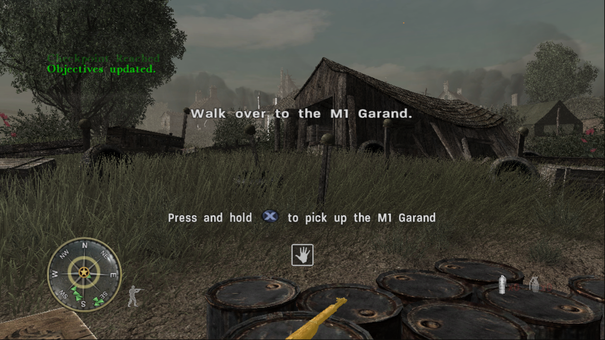

# CoD3Recomp — full campaign + multiplayer fork

**Call of Duty 3 (Xbox 360), statically recompiled to run natively on Windows PC.**
This is a fork of **[FrankHUN88453/CoD3Recomp](https://github.com/FrankHUN88453/CoD3Recomp)**,
built on Frank's recompilation work (made with [XenonRecomp](https://github.com/hedge-dev/XenonRecomp)).
Full credit to Frank for the original port: the recompiled engine, the kernel, the Direct3D 11 renderer
and the installer all come from his project.

> **Where this fork is at:** Frank's public 0.4.0 build only let me play through the first 4–5 campaign
> missions. In this fork **the whole campaign plays through**, and **multiplayer works** — System Link
> over LAN or Tailscale, with bots, custom classes, DLC maps and restored cut content.
>
> Current source version: **0.5.424**. Every change since 0.4.0 is logged in
> [docs/PATCH-NOTES.md](docs/PATCH-NOTES.md), newest first.

You need your **own** Xbox 360 disc image of Call of Duty 3. No game files are included in this repository.

## What this fork adds since 0.4.0

**Multiplayer (0.4.1 – 0.4.10)**
- Multiplayer runs: System Link between PCs (LAN or Tailscale), the F11 settings menu for addresses and options
- DLC maps and bots (experimental), custom rules for everyone
- **Domination**, the cut game mode, restored
- Custom classes, loadout extras, aiming and ability tweaks, graphics options and movement fixes

**Campaign weapons in multiplayer (0.5.0 – 0.5.56)**
- The campaign's Lee-Enfield, Sten, FG42 (and scoped FG42), Bren and Mills bomb usable in multiplayer,
  with their models, arms, reload timing, gunshots, reload sounds and pick-up icons
- Memory past 512 MB (big memory), so Poissons and other big maps load whole with the campaign guns
- Pick up and swap the gun in your hands; dying drops the gun you are holding; aim in the air

**Console, binoculars and killstreaks (0.5.57 – 0.5.84)**
- The developer console works in multiplayer (`devmap`, `god`, `noclip`, `setviewpos`, ...)
- Binoculars for every class (d-pad up / down, light zoom)
- **Killstreaks**: UAV (enemies on the compass), artillery barrage, and the **Typhoon strafing run**
- A **killstreak box** on the HUD (MW2 style): d-pad down picks, d-pad right calls in;
  strikes are marked with the spotter's binoculars. Players who join get their artillery/Typhoon armed too.
- `streak_give uav|artillery|typhoon` for testing

**Vehicles and the Kangaroo APC (0.5.59 – 0.5.86)**
- `spawnvehicle`, vehicles on any map (`vehicles_everywhere`), saved vehicle spots (`vehicle_mark`, `vehicle_clear`, `vehicle_list`)
- The campaign's **Kangaroo APC** brought into multiplayer as its own vehicle: drivable, mountable gun,
  six passenger seats, its own driving curve, wheels, suspension and treads drawn

**Menus and textures**
- Texture replacement packs; the menu art, banners, fonts, controller diagrams and HUD icons upscaled 4×

**HDR mode, on RenoDX**
- F11 → **HDR**: an scRGB HDR picture. The game's 8 bit colour targets become 16 bit float, so fire,
  sky and muzzle flashes keep their highlights. The frame is tone mapped right after the bloom and
  before the HUD, which keeps its own brightness.
- Tone mappers: Vanilla, None, ACES, RenoDRT, PsychoV 17 / 22 / 30 and Prism; peak, game and UI
  brightness, gamma correction, the console's TV gamma ramp, film upgrade and bloom strength
- F11 → **RenoDX**: RenoDX's sliders (exposure, highlights, shadows, contrast, saturation, highlight
  saturation, blowout, flare, hue correction, cone response), applied as they move
- Built on **[RenoDX](https://github.com/clshortfuse/renodx)** by Carlos Lopez Jr. and its contributors
  (MIT; `thirdparty/renodx`), with the **Prism** tone mapper by Musa Haji and OopyDoopy / KickFister / Jon
  (MIT; `thirdparty/prism`)

**Controls, menus and the Kangaroo (0.5.87 – 0.5.183)**
- Kangaroo entry/exit improvements, native controller sensitivity up to 200%,
  persistent audio/controller settings, and menu input fixes
- Sniper steady aim; a saved position (hold R3) and a return to it (hold X)

**Bots (0.5.109 – 0.5.416)**
- Visible, named bots ("Bot 1" to "Bot 24") that are seen by everyone in the match, not only the host
- They fight properly: cover, prone, flanking, smoke, grenades, mines, rifle grenades, melee charges,
  aiming down sights and overwatch sniping; medics revive; they learn each map as you play,
  get unstuck, use ladders, vehicles and mounted guns
- Customizable bot kits, classes and roles (including the Demolitionist), and bots as a lobby setting

**32 players (0.5.206 – 0.5.364)**
- Matches past the console's 24-player limit, up to 32, with the scoreboard, rank and status icons
  and vehicles all working for the extra players

**Killstreaks: the UAV plane and the mortar (0.5.253 – 0.5.331)**
- The UAV as a real plane circling the map (the Typhoon for the Allies, the Stuka for the Germans)
  that you can shoot down, with hit markers and engine and flyby sounds, shown to everyone in the lobby
- A mortar killstreak built from the campaign mortar, with its camera matched to the campaign's

**Killcam (0.5.321 – 0.5.418)**
- A true replay of your death through the killer's eyes: everyone in their real poses and places from
  that moment, the killer's real aim and gun, you in the picture, timed like Call of Duty 4

**Co-op campaign (experimental, 0.5.223 – 0.5.320)**
- A co-op campaign experiment (Forest) with shared films and smoother movement, merged in steps

**HD textures and photo modes**
- UPSCALE-TEXTURES.bat upscales a map's textures 4× on your graphics card (see HD-TEXTURES-README.txt)
- F10 photo mode and a free-fly photo mode

**Performance (0.5.369 – 0.5.424)**
- Goal: a steady 60 fps on Marseille (ordnance) at 32 players. Benchmarks (`BENCH-MARSEILLE*.bat`),
  a second drawing thread for heavy frames, pooled script fibers, and game functions made native, each
  checked against the game's own code for the first few thousand calls of a match
- The main thread went from 17.4 ms to about 12.7 ms a frame in Marseille's city views; without
  profilers the light views run about 81 fps. The heaviest views (5000+ draws) are now limited by the
  command and drawing threads (about 3.1–3.4 µs a draw each)
- Requires a CPU with SSE4.2 (x86-64-v2); no AVX2 needed

## Where it stands (0.5.424)

- Open: confirming the killcam freeze fix (0.5.418) in a two-player game; the effects crash and one
  heap-full freeze are guarded (`fxguard:` / `heapwait:` in CoD3MP.log) but their causes are not found
- Every performance change since 0.5.391 can be switched off with an environment variable; they are
  listed in [patch notes](docs/PATCH-NOTES.md) under each build

See [patch notes](docs/PATCH-NOTES.md) for build history and
[handoff](docs/HANDOFF.md) for the current checkpoint. This is a source
update; no game data, recompiled game code or compiled game executables are published here.

## Original README (Frank's project)

# CoD3Recomp

> **Still in development: bugs can and will occur.** A build ready to play,
> with your own Xbox 360 disc image, is on the
> [releases page](https://github.com/FrankHUN88453/CoD3Recomp/releases).
>
> *Még fejlesztés alatt: hibák előfordulhatnak.*

Static recompilation of Call of Duty 3 (Xbox 360) to native x86-64, using
[XenonRecomp](https://github.com/hedge-dev/XenonRecomp).

The game's PowerPC code translates to C++ and compiles cleanly: 19,462
functions, every instruction translated. All 179 Xbox 360 kernel imports are
implemented, memory mapped I/O reaches the GPU register file, and a command
processor decodes the packets the graphics driver queues.

`CoD3.exe` installs the game from your own disc image and boots it into a window.
The first level, Saint-Lô, is playable: the menus, the loading screen, the
opening cutscene and the fighting run at the title's own 60 frames a second
on the host's GPU through a Direct3D 11 renderer built for a PC (see
[docs/renderer.md](docs/renderer.md)), drawn from the title's own shaders
translated to HLSL, with the terrain, the buildings, the soldiers, the grass,
the sky, the shadows, the HUD and the saved checkpoints all working, at the
window's resolution with mip mapped, anisotropically filtered textures,
FXAA and vertical sync. All fifteen levels' code is recompiled and every
level loads and plays, the mission title cards, the mission failed screen
and the checkpoints with them. The sound plays, the title's XMA voices
decoded through FFmpeg, and so do the films: the legal notice, the
Activision and Treyarch logos, the attract loop and each mission's
briefing, through the title's own player, with Space (the A button) to
skip them.



### Keys and mouse

The keyboard and mouse stand in for the console's pad. In a level the window
takes the mouse and looks with it; Escape gives it back and pauses; a click
takes it again. Every key can be changed in the settings menu.

The look reads the mouse's own movement, the counts its device reports,
rather than following the pointer across the screen: Windows' pointer
speed and its "enhance pointer precision" do not reach it, so the same
sweep of the hand is the same turn on every machine. The settings menu
turns that off for anyone who wants the pointer's travel back.

| | |
| --- | --- |
| Mouse | look; Mouse 1 fires, Mouse 2 aims; the wheel changes weapon |
| W A S D | move |
| Space | jump |
| C | crouch |
| E / R | use / reload |
| F | change weapon |
| V | melee |
| G / 4 | grenade / smoke |
| Shift | sprint |
| Tab | objectives |
| Escape | pause |
| Enter, arrows | the menus |
| F11 | settings menu |
| F12 | screenshot into `screenshots/`, the next two frames' draws into `CoD3.log`, and a small picture after each draw of the next frame (`screenshots/*-draws.bin`): press it when something looks wrong |
| ` (the key left of 1) | the console, when the settings' Gameplay page turns it on |

The settings menu (F11, and it opens by itself when OPTIONS is chosen in
the title's main menu, over the title's own options page) has the window
mode (windowed or borderless full screen; Alt+Enter switches too), the
resolution (the desktop's by default; the window is made that size, full
screen scales it, and the frame is drawn at it) and the resolution scale
in per cent of it, the texture filtering
and anisotropy, anti aliasing (MSAA 2x to 8x, FXAA, or both), the
texture quality, the field of view (65 to 100), the model detail (the
game's own level of detail, or the finest model at every distance), the
blur while aiming,
vertical sync, the frame rate in a level (unlimited by default: a level
is played at what the machine can do, around a hundred frames a second
where the console had sixty, while the menus keep 60 and the films
their 30), a frame counter and the renderer's statistics, the mouse
sensitivity and whether the mouse is read raw, the title's aim assist,
the pad, and the keys; on its Gameplay page the subtitles (the title's
`cg_subtitles`) and the console, and on its Experimental page the native
command lists and the memory write watch (both on by default; the draws
come from the game's own D3D calls rather than from its GPU command stream). It is drawn
in the colours of the title's own menus. It keeps its values in `CoD3Recomp.ini` beside the
executable. Everything the game prints goes to `CoD3.log` beside the
executable as well as to its console, and the run before is kept as
`CoD3.previous.log`: after a freeze or a crash, that file says where every
thread stood (`COD3_LOG=0` turns it off, `COD3_LOG=path` puts it
elsewhere). The same settings can be forced
from the environment for a run: `COD3_SCALE`, `COD3_TEXTURE_FILTER`,
`COD3_RESSCALE`, `COD3_ANISO`, `COD3_AA`, `COD3_TEXQUALITY`, `COD3_MODELDETAIL`, `COD3_AIMBLUR`, `COD3_VSYNC`, `COD3_UNLOCKFPS`, `COD3_FULLSCREEN`;
`COD3_EXEC="command;command"` runs the title's console commands at start;
`COD3_RENDER_STATS=1` prints the renderer's counters once a second and
`COD3_RENDER_PROFILE=1` where a draw's microseconds go.

The console (the key left of 1, which the title's own configs bind to
`toggleconsole`; off until the Gameplay page turns it on) drops from the
top of the screen as the Call of Duty engines' own does, and takes the title's console commands and puts them on its
command buffer, the way the chapter select starts a level: `spmap forest`,
`map_restart`, `cg_fov 80`, `timescale 0.5`, `god`, `noclip`, `give all`,
`seta com_maxfps 60`. The title's own console was stripped from this build
(its `toggleconsole` command and its `Com_Printf` are gone), so the
commands run but the title says nothing back; `help` lists examples,
`clear` empties the log, Escape closes it.

Saved games go to `saves/` beside the executable.

A pad works as well when one is plugged in.

Read [STATUS.md](STATUS.md) for what works, how it was measured, and what a
playable build would take.

The instructions this project added to the recompiler are checked against Xenia's
PowerPC instruction tests, and all 16 that have a test pass.

## Build

```powershell
.\scripts\recompile.ps1 -BuildTools -BuildLib -BuildHost
```

Needs CMake 3.20+, Ninja, Clang, and the Visual Studio Build Tools for the
Windows SDK headers. Clang is required, not preferred.

Put your own `default.xex` in `CoD3RecompLib/private/` first, so the recompiler
has something to translate. No game files are included here.

## Verifying

```powershell
.\scripts\verify.ps1        # the instructions this project added
.\scripts\verify.ps1 -All   # every test Xenia has
```

Assembles Xenia's instruction tests, recompiles them the same way the game's
code is recompiled, runs them, and reports any register that comes out wrong.

## Running

`CoD3.exe` looks for a `game` folder next to itself. If it is not there, first
time setup runs and offers three ways to supply the game:

1. Extract from an Xbox 360 disc image. XGD1, XGD2, XGD3 and stripped images are
   all recognised.
2. Copy from a folder you already extracted.
3. Use a folder you already extracted, where it is, copying nothing. The path is
   remembered in `game.path`.

Setup checks that the disc holds a `default.xex` of the same size as the one
this build was recompiled from, before writing several gigabytes.

Started from Explorer, the window waits for a key before closing, so the output
can be read. Started from a shell it exits straight away and leaves the prompt
alone.

The picker dialogs can be skipped:

```
CoD3.exe --iso "D:\path\Call of Duty 3.iso"
CoD3.exe --game "D:\path\Call of Duty 3 (USA, Europe)"
CoD3.exe --list-iso "D:\path\Call of Duty 3.iso"
CoD3.exe --help
```

A level can be started straight from the main menu, the way the chapter
select does it, with `COD3_MAP=<level>[,<second>]` in the environment: at that
second (twelve by default) the title's own `spmap <level>` console command is
put on its command buffer. The main menu has to be up by then, which
`COD3_NOFILMS=1` (no intro films) and `COD3_PAD="5:start 8:a"` (Start at
five seconds, A at eight) see to in a scripted run. The level names are the folders under `sp`: `saint_lo`,
`island`, `nightd`, `crssrds`, `hostage`, `mayenne`, `forest`, `falaise`,
`fuelplnt`, `chambois`, `mace2`, `laison`, `stbert`, `blkbrn`, `credits`.
`COD3_WIN=<second>:<level>` marks the running mission won at that second
with `<level>` as the next, the way a level script does, to test the way
from one mission to the next: the title reboots itself for it, and this
executable starts again with the title's launch data (`COD3_LAUNCHDATA`).
`COD3_CMD="22:god"` puts the title's own console commands on its buffer.

## Layout

| Path | |
| --- | --- |
| `CoD3RecompLib/config/CoD3.toml` | Recompiler configuration, with every address documented |
| `CoD3RecompLib/config/CoD3_switch_tables.toml` | 323 jump tables, from XenonAnalyse |
| `CoD3RecompLib/ppc/` | Generated C++. Never edit; regenerate |
| `CoD3RecompLib/private/` | Your game files. Not in version control |
| `CoD3Host/` | The executable: setup, disc image reader, guest memory, the kernel |
| `CoD3Host/kernel_*.cpp` | The kernel by area: memory, system, objects, files, Xam, threads |
| `CoD3Host/implemented_imports.txt` | Which imports are real. Add a name here when you implement one |
| `CoD3Host/kernel_stubs.cpp` | Generated for everything not on that list |
| `tools/XenonRecomp/` | The recompiler, with local fixes described in STATUS.md |
| `CoD3Host/xenos_hlsl.cpp` | The title's shader microcode translated to HLSL |
| `CoD3Host/render*.cpp` | The renderer: the registers read once (`render_state`), the PC render layer that makes draw commands of them (`render_commands`), the pipeline, shader and resource caches, the stats, and the Direct3D 11 executor and device (`render_d3d11`) ([docs/renderer.md](docs/renderer.md)) |
| `scripts/compare_frames.py` | Compares two runs' frame dumps, for the renderer's visual regression check |
| `scripts/sendkeys.py` | Posts keys to the game's window without taking the focus, for scripted runs (the console included) |
| `CoD3Host/overlay.cpp`, `settings.cpp` | The settings menu (Dear ImGui) and its file |
| `tools/CoD3Scan/` | XEX analysis: finds required addresses, repairs function boundaries, lists imports |
| `scripts/recompile.ps1` | The whole pipeline, the coroutine patch (`scripts/patch_recomp.py main`) included; running XenonRecomp by hand needs that patch afterwards or the first level's scripts spin forever |
| `scripts/verify.ps1` | Checks the recompiler against Xenia's instruction tests |
| `tools/PpcAsm/` | A PowerPC assembler, built from the project's own opcode tables |
| `CoD3Host/gpu.cpp` | The GPU register aperture and the PM4 command processor |
| `thirdparty/imgui/` | Dear ImGui, for the menu |
| `CoD3Host/hdr/cod3_hdr.hlsl` | The HDR mode's passes (the scene's tone map, the scRGB output, the menu's layer), on RenoDX |
| `thirdparty/renodx/` | [RenoDX](https://github.com/clshortfuse/renodx)'s shader library (MIT), for the HDR mode |
| `thirdparty/prism/` | The Prism tone mapper (MIT), for the HDR mode |
| `CoD3Host/sampler.cpp` | Names the guest function each thread is in, without debug symbols |
| `CoD3RecompLib/include/cod3_mmio.h` | Routes guest register access to the GPU instead of RAM |
| `docs/kernel-imports.txt` | The 179 imports a runtime has to provide |

## CoD3Scan

```
CoD3Scan <default.xex>                      # layout, save/restore helpers, longjmp candidates
CoD3Scan <default.xex> --imports            # every kernel import with its thunk address
CoD3Scan <default.xex> --fixfuncs <log>     # explicit function boundaries from a recompiler log
CoD3Scan <default.xex> --func 0xADDR        # which .pdata entry covers an address
CoD3Scan <default.xex> --find D9C30000      # byte-pattern search across code sections
CoD3Scan <default.xex> --disasm 0xADDR 40   # disassemble a window
```
